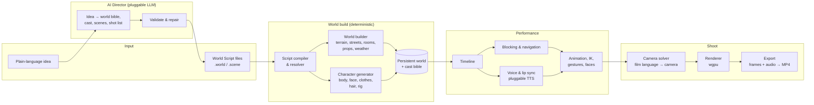
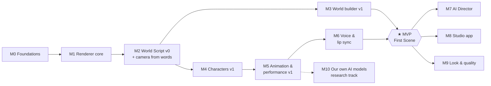

# Development Plan — 3D World Movie Studio

Status: **v0.1, first plan** (2026-10-30). This is a living document; it changes as we learn.
Read [VISION.md](../VISION.md) first. It explains *why*; this document explains *how* and *in what order*.

---

## 1. Ground rules

- **Everything domain-specific is ours:** the engine, renderer, world builder, mesh toolkit, character generator, rigging, animation, camera system, script language and director. No Blender, Unreal, Unity, Godot or Bevy, at runtime or as a build step.
- **Small foundations are allowed** where writing our own adds nothing: GPU abstraction, windowing, maths, serialization, image and audio codecs. Each must be permissively licensed and compatible with AGPL-3.0, and is checked in CI.
- **Open formats at the edges:** glTF 2.0 for importing and exporting 3D, PNG/EXR for frames, WAV for audio, MP4 for film, SRT for subtitles.
- **Every milestone ends in footage.** A milestone is done when it renders something you can watch, and that footage is shown on stream.
- **Determinism from day one.** Same script + same seed = same frames. This is tested, not hoped for.

## 2. Architecture



Key boundary: **the AI only ever writes World Script.** Everything after the script
is deterministic engine code. The AI chooses *what* happens and *which* shot, while
the engine computes coordinates, paths, poses and camera maths. This makes output
reproducible and testable, and lets a human edit anything the AI wrote.

### 2.1 Technology decisions

| Area | Decision | Why |
|---|---|---|
| Language | **Rust** (stable) | Native speed for rendering and simulation, memory safety, single-binary distribution, strong GPU ecosystem, can target WebAssembly later |
| GPU | **wgpu**, shaders in **WGSL** | One API over Metal (Mac), DX12/Vulkan (Windows/Linux) and WebGPU (browser later) |
| Windowing / UI | **winit** + **egui** | Light, permissive, good for tool UIs |
| Maths | **glam** | Fast, SIMD, widely used |
| Serialization | **serde** (JSON for world state, our own text format for scripts) | Diffable, debuggable |
| Video encode | **ffmpeg CLI** as an optional external tool at first; PNG sequence always available | Gets us to watchable MP4 on day one. Revisit an in-process encoder later |
| Our own ML models | Train in Python (`research/`), export to **ONNX**, run in-engine via an ONNX runtime | Keeps the engine Rust-only at runtime |
| LLM | `Provider` trait; Anthropic Claude as default, local model option | Swappable, works offline |
| TTS | `Provider` trait; NoizAI first, a local open TTS second | Swappable, per-character voices |

Alternatives considered: C++ (heavier build and safety burden for a small team) and
TypeScript + WebGPU (fast iteration, but a lower ceiling for offline rendering and
long simulations). Rust + wgpu keeps a browser version possible later without being
browser-limited now.

### 2.2 Repository layout (target)

```
3d-world-movie-studio/
├── crates/
│   ├── wms-core        # ids, deterministic RNG, time, math helpers, errors
│   ├── wms-script      # World Script grammar, parser, AST, diagnostics
│   ├── wms-world       # world state: scene graph, places, anchors, cast bible, persistence
│   ├── wms-resolve     # script → world + timeline (blocking, anchors, constraints)
│   ├── wms-geo         # mesh data + procedural modelling ops (extrude, loft, bevel, booleans, UVs)
│   ├── wms-worldgen    # terrain, streets, buildings, interiors, props, vegetation, weather
│   ├── wms-character   # parametric humans, face morphs, clothing, hair, auto-rig & skin weights
│   ├── wms-anim        # skeletons, clips, blending, IK, locomotion, gestures, facial
│   ├── wms-camera      # shot vocabulary → camera solve, cinematography rules
│   ├── wms-audio       # TTS providers, phoneme/viseme timing, mixer, ambience
│   ├── wms-render      # wgpu renderer: materials, lights, shadows, sky, post
│   ├── wms-director    # LLM providers, prompts, script generation, validate/repair
│   └── wms-export      # frame sequences, video mux, subtitles
├── apps/
│   ├── wms-cli         # `wms render`, `wms preview`, `wms check`
│   └── wms-studio      # desktop studio app (egui)
├── assets/             # licence-clean sample assets, each with licence metadata
├── examples/           # sample .world/.scene scripts (tea stall, etc.)
├── tests/golden/       # golden-image and golden-audio references
├── research/           # Python training code for our own models (not shipped in the engine)
└── docs/
    ├── adr/            # architecture decision records
    └── spec/           # World Script specification
```

`wms` = **W**orld **M**ovie **S**tudio, the CLI name and crate prefix (provisional).

## 3. Milestones

Sizes are rough, for one developer working with AI assistance:
**S** ≈ 1–2 weeks · **M** ≈ 3–5 weeks · **L** ≈ 6–10 weeks. Treat them as a sense of
scale, not deadlines.



### M0 — Foundations · S
Goal: an empty but real pipeline, from script file to MP4, with tests and CI.
- Cargo workspace with the crate layout above (stubs where empty).
- CI: `fmt`, `clippy`, tests, `cargo-deny` (licences and advisories), gitleaks secret scan.
- `wms-core`: seeded deterministic RNG, fixed-timestep clock, stable IDs.
- Window with a wgpu surface (Mac, Windows, Linux).
- **Headless offscreen rendering** to PNG (no window needed).
- PNG sequence → MP4 via ffmpeg when available.
- Golden-image test harness: render, compare against reference with per-backend tolerance, write diffs on failure.
- Contribution policy decided (see §6).

**Done when:** `wms render examples/hello.scene` makes a 3-second MP4 of a lit, turning cube, and running it twice produces identical frames.

### M1 — Renderer core · M
Goal: a renderer good enough to make a simple scene look intentional.
- Mesh, material and texture pipeline; GPU instancing.
- Forward renderer with depth pre-pass; HDR targets; tonemapping; MSAA.
- Shading models: **stylized PBR** and **toon** (ramp shading + outlines).
- Directional sun with cascaded shadow maps; point and spot lights.
- Physical sky with time-of-day sun position; fog and atmospheric perspective.
- glTF 2.0 import/export for interop and debugging.

**Done when:** a street blocked out of primitives renders at sunrise, noon and dusk, with readable shadows, sky and fog.

### M2 — World Script v0 + camera from words · M
Goal: words control the world and the camera.
- World Script v0 grammar and spec (`docs/spec/world-script.md`). The VISION.md sample is the starting draft.
- Parser with friendly, line-numbered errors (`wms check`).
- Places with **named anchors** ("counter", "awning", "bus stop") that the script refers to instead of coordinates.
- WHEN → sun, sky, light presets; weather flags.
- Timeline: scenes, beats, shots, durations.
- **Shot vocabulary v0:**
  - Sizes: extreme close-up, close-up, medium close-up, medium, medium-long, long, extreme long.
  - Angles: eye level, high, low, overhead, dutch.
  - Framings: single, two-shot, over-the-shoulder, POV, insert.
  - Moves: static, pan, tilt, dolly in/out, push-in, pull-out, track, orbit, crane.
- Camera solver: frame subject bounds for a given shot size and lens; respect the 180° line between characters; avoid occluders.

**Done when:** a script with placeholder "actors" (capsules) and three worded shots renders the framings a cinematographer would expect.

### M3 — World builder v1 · L
Goal: our own procedural world creation, from a place description to a set that can be filmed from any angle.
- `wms-geo` modelling toolkit: extrude, loft, sweep, bevel, inset, simple booleans, subdivision, normals, automatic UVs.
- Procedural materials: brick, plaster, concrete, asphalt, wood, tin, metal, fabric, foliage. Parameterized, with wear and wetness.
- Terrain (heightfield + light erosion) and street layouts from splines (roads, kerbs, footpaths).
- Buildings via a **shape grammar**: storeys, facades, windows, doors, awnings, shutters, signboards.
- Interiors: room layout, walls, doors, windows, floors, ceilings.
- **Parametric prop library:** tables, chairs, benches, stalls, lamp posts, bus stop, cups, kettles, umbrellas, crates, and more over time.
- Vegetation: L-system trees and shrubs, grass cards.
- Weather: rain particles, wet surfaces, puddles, wind.
- Place description → layout: the description chooses kits and constraints, and a solver arranges them deterministically from a seed.
- Era and region style packs (first: South Indian street, 1980s).

**Done when:** the tea-stall street from VISION.md is generated from its text description and can be explored freely in the viewport.

### M4 — Characters v1 · L
Goal: our own character creation. Cast once, the same actor forever.
- **Our own base human mesh:** clean quad topology built for deformation, with proper face and joint loops. Authored with our own tools and stored as source.
- Parametric body: height, build, age, proportions as blend shapes.
- Parametric face: eyes, nose, mouth, jaw, cheeks, brows, ears.
- Skin, eye and hair shading (stylized).
- **Layered parametric clothing** fitted to the body: shirts, vests, trousers, veshti, saree, salwar, footwear. Region and era packs grow over time.
- Hair: cards first, simple strands later.
- Skeleton generation and **automatic skin weights**.
- Character description → parameters → **Cast Bible** entry with a locked identity seed. The identity can't drift once cast.

**Done when:** Ravi and Meena are generated from their one-line descriptions and shown in a turntable that matches the text.

### M5 — Animation & performance v1 · L
Goal: characters that move with intent.
- Skeleton, pose, clip and blend-tree system; animation layers and masks.
- IK: two-bone for arms and legs, foot planting, head and eye look-at, reach and hold.
- Navigation mesh from the built world; path following; avoidance.
- Locomotion: walk, run, turn, start and stop; sit and stand; carry, hold, pour.
- Procedural idles: breathing, weight shifts, small fidgets.
- Gesture library and **verb mapping** ("runs in", "shelters", "pours tea", "shakes out the umbrella").
- Facial rig: expression set (FACS-inspired) plus visemes; blinks, eye saccades, gaze targets.
- BVH import to build our clip library from licence-clean motion capture.

**Done when:** Meena runs in from the rain and stops under the awning; Ravi pours tea; both idle believably between actions.

### M6 — Voice & lip sync · M
Goal: characters that talk.
- TTS `Provider` trait; NoizAI provider; one local provider.
- Per-character voice stored in the Cast Bible.
- Word and phoneme timing (from the provider, or by forced alignment); phoneme → viseme with coarticulation smoothing.
- Delivery tags in scripts ("laughing", "whispering", "angry") drive voice style, expressions and gestures.
- Audio timeline and mixer: dialogue, ambience (rain, traffic), room tone. SRT subtitles.

### ★ MVP — "First Scene"
**The VISION.md tea-stall scene, rendered end to end from its script on a MacBook Air:**
a generated street, two generated characters, three worded shots, voiced and
lip-synced dialogue, exported as a 1080p MP4. The script is still written by hand;
the AI Director comes next.

### M7 — AI Director · M
- LLM `Provider` trait; Claude provider; local provider.
- Idea → world bible → cast → scenes → shot lists, all emitted as World Script.
- Output checked against the script schema, with an automatic validate-and-repair loop.
- Cinematography rules: coverage, 180° line, eyeline match, shot variety, pacing.
- **Edit by instruction:** "make it night", "add a reverse shot on Meena", "Ravi should be angrier". Each produces a script diff you can review.

**Done when:** a one-paragraph story becomes a complete scene film, and plain-language edits update it.

### M8 — Studio app · L
- Desktop app: script editor with live validation, viewport, cast and places panels, shot list, timeline.
- Fast low-resolution preview; final render queue.
- Click-to-reshoot: pick a moment, describe a new shot, preview it.

**Done when:** the full workflow runs without the command line.

### M9 — Look & quality · L
- Ambient occlusion, light probes or irradiance volumes, soft shadows.
- Depth of field, motion blur, bloom, per-film colour grading.
- Optional **path-traced final mode** (compute shaders).
- Optional **AI look pass** plug-in, off by default: repaints shots in a chosen style, guided by our depth, pose and segmentation passes.

### M10 — Our own AI models · research track (parallel from M5)
- Text-to-motion and speech-to-gesture models for natural acting.
- Image → character parameters (fit our parametric model, not free-form meshes).
- Image or sketch → place layout.
- Trained **only on licence-clean data**, with a data card per model. Many popular motion datasets are non-commercial only (e.g. AMASS and datasets derived from it), so they are excluded. Models are exported to ONNX and run in-engine.

## 4. Cross-cutting requirements

### Determinism
- Fixed timestep; no wall-clock time in simulation or rendering.
- One seeded RNG stream per subsystem, derived from the script seed.
- Stable iteration order wherever output is affected (no hash-map iteration order leaks).
- GPU results can differ slightly between vendors, so golden tests use per-backend tolerance, and CPU-side state must match exactly.

### Performance targets (Apple Silicon MacBook Air)
- Preview: ≥ 24 fps at 720p for the MVP scene.
- Final render, stylized: about 1 s per 1080p frame or better (a 30-second scene in roughly 12 minutes or less).
- World and cast build for the MVP scene: under a minute.

### Testing
- Unit tests per crate; World Script fixture corpus (valid and invalid scripts with expected diagnostics).
- Golden images and audio for every milestone's demo scene.
- Performance benchmarks tracked in CI.

### Licence hygiene
- `cargo-deny` enforces AGPL-compatible dependency licences.
- Every bundled asset has licence metadata; no non-commercial or unclear assets.
- Every dataset and model has a data card stating its source and licence.

### Security
- No secrets in the repo; gitleaks in CI and as a pre-commit hook.
- Provider keys come from environment variables only and are never logged or printed.
- Dev setup is safe for live streaming (see §7).

## 5. Risks

| Risk | Impact | Mitigation |
|---|---|---|
| Acting looks stiff | High: it's what viewers notice first | Prioritise IK, idles, gaze and facial work in M5; build a curated gesture library; research track for learned motion |
| Our own base character mesh and clothing need real art skill | High | Start stylized (more forgiving); iterate the topology on stream; invite artist contributors early |
| Procedural places look generic | Medium | Region and era style packs; wear and dirt; strong lighting and weather |
| Scope creep into a general 3D tool | High | VISION's "is / isn't" table is the filter; every feature must serve "words → film" |
| LLM output breaks the script | Medium | Schema validation, repair loop, human-editable scripts |
| Cross-GPU rendering differences | Low–medium | Tolerance-based golden tests per backend |
| Solo bandwidth | High | Milestones that each ship footage; build in public to attract contributors |

## 6. Open decisions

1. **Contribution policy:** CLA (keeps a commercial dual licence possible) or DCO (simpler for contributors). Decide **before the first external code PR**.
2. **World Script syntax:** the VISION.md sample is a draft. Finalise it in M2 with a written spec.
3. **Local TTS default** for offline use.
4. **Video encoding:** keep ffmpeg as an external tool, or build an in-process encoder.
5. **Names:** `wms` for the CLI and crate prefix is provisional.

## 7. Building in public

- Development is streamed on Twitch (Software and Game Development), with VODs on YouTube.
- Every milestone gets a demo stream and a short clip of the footage.
- **Stream-safe setup:** a dedicated workspace or OS user, window capture only, notifications off, stream delay, and keys outside the repo with spending limits. If a key appears on stream, rotate it immediately.

## 8. First steps

1. M0 workspace, crate stubs and CI.
2. wgpu window + headless offscreen render to PNG.
3. Deterministic RNG + golden-image harness.
4. `hello.scene` → turning cube → MP4. **First stream milestone.**
